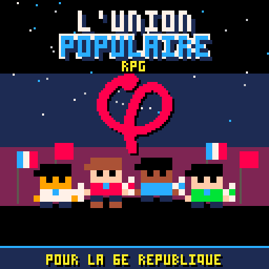

# φ L'Union Populaire : Le RPG (PICO-8)

Un RPG rétro complet sur **PICO-8** autour de la campagne présidentielle de **l'Union Populaire** et du programme *L'Avenir en Commun* pour la **6e République**.

👉 **Jouer directement dans le navigateur (PC, Mobile & Manette) :**
**[https://boblefrag.github.io/union-populaire-rpg/](https://boblefrag.github.io/union-populaire-rpg/)**

## ✊ Présentation
Parcourez le pays de **Saint-Denis** à **Marseille** en passant par **Lille**, **Nantes** et **Toulouse**, débattez face aux éditorialistes, lobbyistes et technocrates, brisez les 4 grands monopoles (*Tour des Médias*, *Banque Offshore*, *Tour d'Austérité*, *Lobby Central*) pour inscrire les mesures phares de *L'Avenir en Commun* au programme, et instaurez la **6e République** !

### Les 4 Profils Militants
- **Militant** : Militant LFI de terrain, haute conviction et grande force d'argumentation directe en porte-à-porte et débat.
- **Streamer** : Spécialiste de la mobilisation médiatique (*Débat en direct*, *Tribune libre*, *Onde populaire*, *Cordon syndical*).
- **Street Medic** : Soutien solidaire de l'équipe (*Sérum phy*, *Services publics*, *Bouclier social*) jusqu'à l'action ultime *La Constituante*.
- **Fact-checker** : Agilité maximale et *Recul médiatique* permettant d'esquiver la polémique et de contrer ×3.

## 🎮 Commandes
- **Flèches directionnelles** : Se déplacer / Naviguer dans les menus
- **Bouton O (`Z`, `C` ou `N`)** : Valider / Convaincre / Interagir
- **Bouton X (`X`, `V` ou `M`)** : Annuler / Ouvrir le menu de terrain (*Statut, Matériel, Mobilisation*)
- **Entrée / `P`** : Menu Pause PICO-8

## 🛠️ Développement & Commandes PICO-8
| Action | Commande |
|---|---|
| Assembler la cartouche | `python3 tools/build.py` |
| Lancer dans PICO-8 | `./pico-8/PICO-8.app/Contents/MacOS/pico8 -run main.p8` |
| Exporter la page web | `./pico-8/PICO-8.app/Contents/MacOS/pico8 legend_of_the_gems.p8 -export index.html && python3 tools/build_pages.py` |
| Exporter la cartouche `.p8.png` | `./pico-8/PICO-8.app/Contents/MacOS/pico8 legend_of_the_gems.p8 -export union_populaire_rpg.p8.png` |
| Lancer les tests | `./pico-8/PICO-8.app/Contents/MacOS/pico8 -x tests/smoke.p8 && ./pico-8/PICO-8.app/Contents/MacOS/pico8 -x tests/smoke_story.p8` |

Jouer sur console portable rétro (TrimUI Brick, Miyoo, Anbernic…) : voir [docs/trimui.md](docs/trimui.md).
